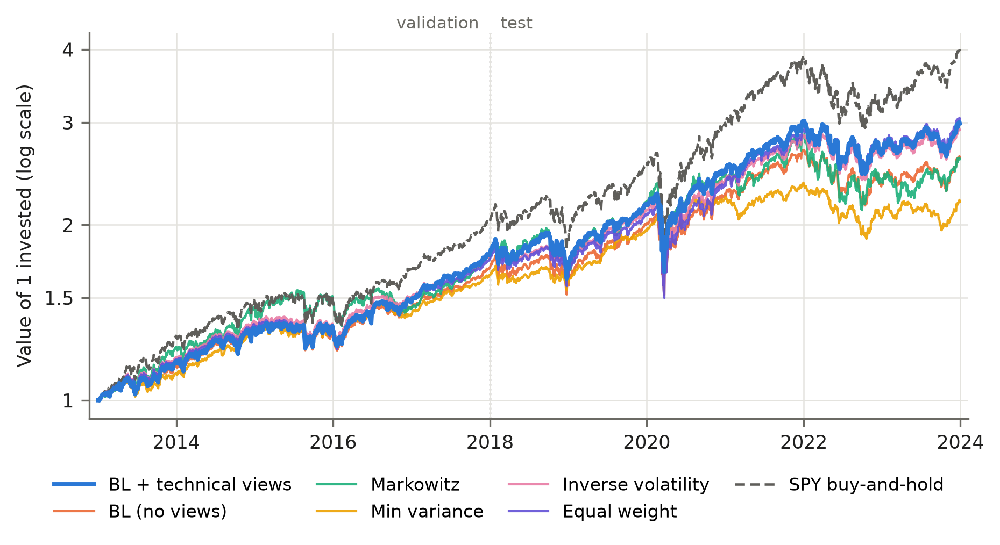
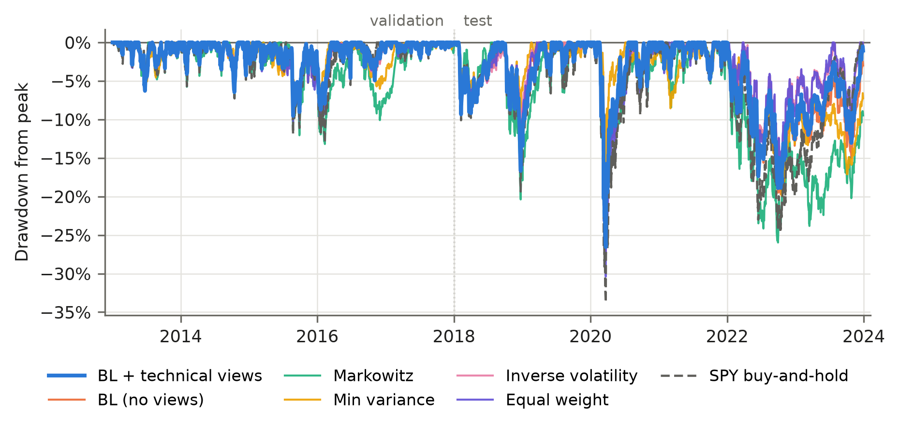
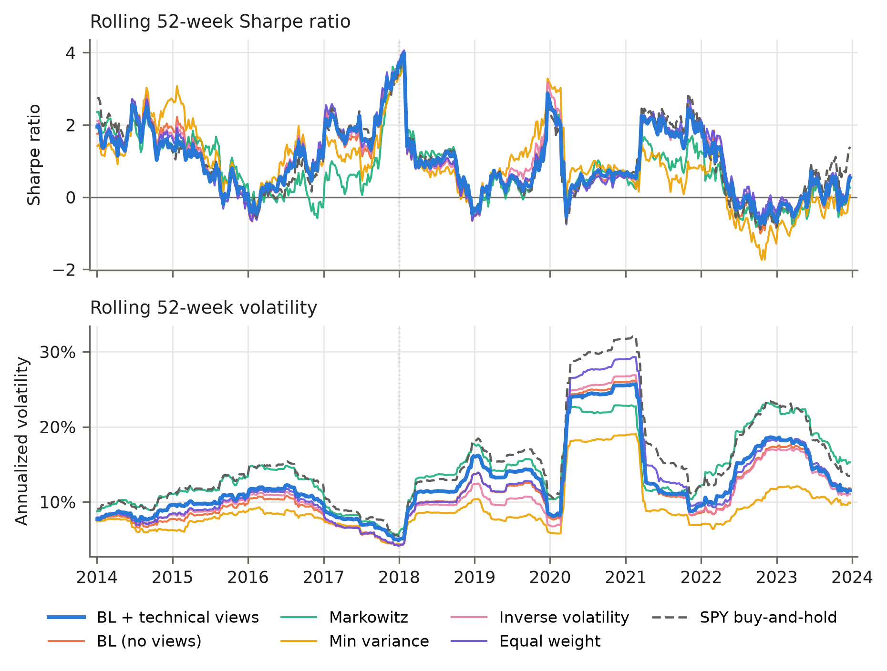

# MacroNews Portfolio Lab

A Black--Litterman portfolio simulator for U.S. sector ETFs, driven first by technical
signals and designed to incorporate news signals later (COMP3090 Course-related Project 2,
VinUniversity).

Momentum, short-term reversal and volatility currently produce *technical views*.
Black--Litterman blends those views with market-implied returns, and a long-only
mean--variance optimizer with a turnover penalty rebalances the portfolio every week.
The planned NLP pipeline will later add news views from Federal Reserve communications and
financial news.

The central research question: **do news-based views add information beyond what prices
already reflect?**

> Educational research tool. It replays historical data only, performs no live or paper
> trading, and is not investment advice.

## How it works

The project runs in two phases.

**1. Prepare (offline, once).** Daily ETF prices and the 3-month T-bill rate are downloaded
for 2009--2023 and stored in a single SQLite file, `data/macronews.db`. Nothing in this
phase makes portfolio decisions. FOMC/news ingestion and NLP scoring are the next extension.

**2. Replay (the simulation).** The simulator walks forward one week at a time, as if living
through the period. At each weekly decision date *t* (the last trading day of the week) it
sees **only** what was knowable at that moment:

- prices up to the close of *t*;
- documents published up to 16:00 ET on *t* (later documents count towards the next week).

From that snapshot it estimates risk, builds technical views, computes the
Black--Litterman posterior and solves for new target weights. Trades are executed at the
close of the next trading day; between rebalances the portfolio is marked to market daily.
Then the clock advances to week *t + 1*.

```
              prepare (once)                          replay (week by week)
 ┌──────────────────────────────────┐      ┌───────────────────────────────────────────┐
 │ prices and T-bill                │      │ for each week t:                          │
 │   → data_pipeline → SQLite       │ ───▶ │   snapshot of data known at t             │
 │ future: documents → nlp → indices│      │   → views → Black--Litterman → QP         │
 └──────────────────────────────────┘      │   → trade at t+1 close → mark to market   │
                                           └───────────────────────────────────────────┘
```

Look-ahead bias is the main failure mode of a backtest, so every component that touches time
has unit tests for it. The 2018–2023 test period is evaluated only once, at the end.

## Repository layout

```
├── config.yaml          experiment parameters (universe, periods, model settings)
├── common/              shared foundation: config loader, weekly decision calendar
├── data_pipeline/       download, clean and store data in SQLite
├── nlp/                 reserved for topic labels, FinBERT, scoring and news indices
├── optimization/        risk model, Black–Litterman, mean-variance QP, baseline strategies
├── simulation/          week-by-week replay, view generation, rebalancing, metrics
├── backend/             FastAPI service (planned)
├── frontend/            React web interface (planned)
├── tests/               pytest suite
├── data/                local data and the SQLite database (git-ignored)
└── docs/                project description and proposal
```

Folders are plain Python packages run from the repository root; nothing needs to be
installed as a package.

## Getting started

Requires Python 3.11 or newer.

```bash
python3 -m venv .venv
source .venv/bin/activate
pip install -r requirements.txt
cp .env.example .env        # optional: only to change data paths
pytest
```

The NLP stack (PyTorch, Transformers) is large and only needed where FinBERT is fine-tuned or
used for scoring, typically on a cloud GPU:

```bash
pip install -r requirements-nlp.txt
```

## Configuration

All experiment parameters live in [config.yaml](config.yaml), with values taken from the
proposal. Load them with `common.config.load_config()`; individual values can be overridden
for experiments without editing the file:

```python
from common.config import load_config

cfg = load_config(overrides={"optimizer.w_max": 0.25, "news.half_life_days": 7})
```

Each saved simulation run stores the full configuration it used. Data paths
(optional `MACRONEWS_DATA_DIR`, `MACRONEWS_DB_PATH`) are read from `.env`.

## Run the technical experiment

The experiment runner constructs one shared point-in-time input object, then runs the main
method and every comparator over the same dates. It caches the Ledoit--Wolf covariance for
each decision date, so all strategies use the same risk estimate. At a Friday decision date
the main strategy uses only data available by that close:

```
daily/weekly returns up to t
  → Ledoit--Wolf covariance → equilibrium prior
  → MOM / REV / VOL → Ridge technical views
  → Black--Litterman posterior → constrained QP target weights
  → execution at the next trading-day close → daily mark-to-market
```

```bash
# Development / validation run only: preserves the 2018--2023 holdout.
python -m simulation.experiment --start 2013-01-01 --end 2017-12-31 --out reports/validation
python -m simulation.report --out reports/validation
```

The runner writes NAV, weekly returns, turnover, weights and metrics under `results/`; the
report command turns these into PDF/PNG figures and CSV/LaTeX tables. Do not inspect and tune
against 2018--2023 while developing parameters: doing so turns that intended final holdout
into validation data.

### Methods compared

| Method | Purpose |
|---|---|
| BL + technical views | Main method: equilibrium prior plus Ridge forecasts from momentum, reversal and volatility. |
| BL (no views) | Isolates the incremental value of technical views. |
| Markowitz | Uses historical mean excess returns instead of the Black--Litterman prior. |
| Minimum variance | Uses covariance only to target the lowest-risk allocation. |
| Inverse volatility | Uses each asset's own volatility, ignoring correlations and return forecasts. |
| Equal weight | Transparent 1/N allocation comparator. |
| SPY buy-and-hold | Market benchmark: the outcome of buying SPY once and holding it, not a portfolio-optimization baseline. |

## Current report artifacts

The committed artifacts in [`reports/`](reports/) were generated for **2013--2023** and
therefore include both the development period and the intended 2018--2023 holdout. They are
useful for checking the end-to-end pipeline, but should not be presented as the untouched
final test if their results informed any design choice.







The corresponding [performance table](reports/tables/t1_metrics.csv) and
[calendar-year returns](reports/tables/t2_annual_returns.csv) are also available. In this
2013--2023 exploratory run, SPY has the largest annualized return (13.3%) and Sharpe (0.78),
while BL + technical views has lower annualized volatility (13.2% versus 16.2%) and smaller
maximum drawdown (26.5% versus 33.7%). This is a return--risk trade-off, rather than evidence
that the active allocation beats the market benchmark.

## Data

| Source | Content | Access |
|---|---|---|
| Yahoo Finance | Daily adjusted prices: 9 SPDR sector ETFs, TLT, GLD, SPY (XLRE, XLC optional) | `yfinance` |
| FRED | 3-month T-bill rate (DTB3), the risk-free rate | public CSV export, no key |
| Federal Reserve | FOMC statements, minutes, press-conference transcripts (planned) | public website |
| FNSPID | Time-stamped financial news linked to S&P 500 tickers (planned) | public dataset |
| Financial PhraseBank, Shah et al. (2023) | Labelled sentiment and hawkish/dovish sentences (planned) | public datasets |

Data files and the database are not committed; they are rebuilt by the pipeline. All sources
are used under their terms of use.

## Status

Development follows the milestones in [plan.md](plan.md): the price-based path is built
first, so a working technical-only simulation exists before the NLP path is added.

| Milestone | Scope | Status |
|---|---|---|
| C0 | Configuration, decision calendar, SQLite storage | Done |
| C1 | Market data download, storage, returns and validation | Done |
| C2 | Ledoit--Wolf risk model, equilibrium prior, Black--Litterman, constrained QP and baselines | Done |
| C3 | Momentum, reversal and volatility features; purged Ridge technical views | Done |
| C4 | Weekly point-in-time replay, execution lag, costs, metrics and saved runs | Done |
| C4 reporting | Experiment runner; PDF/PNG figures and CSV/LaTeX tables | Done |
| C5--C7 | Text collection, NLP scoring, news indices and news views | Planned |
| C8 | Final evaluation, ablations, placebo and sensitivity analysis | Planned |
| C9--C10 | Web simulator and final deliverables | Planned |

## Documentation

- [docs/project_proposal.pdf](docs/project_proposal.pdf): full methodology
- [docs/project_description.pdf](docs/project_description.pdf): project summary
- [plan.md](plan.md): implementation plan, schedule and design decisions
